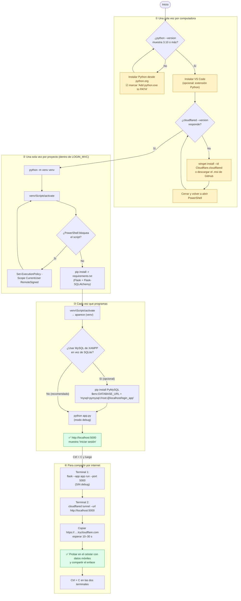
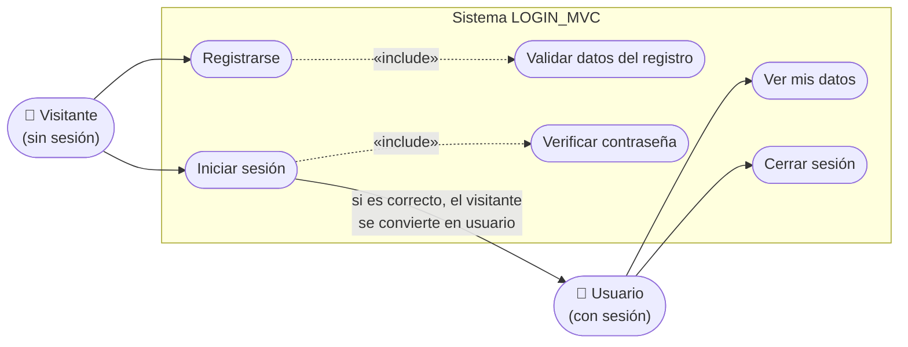
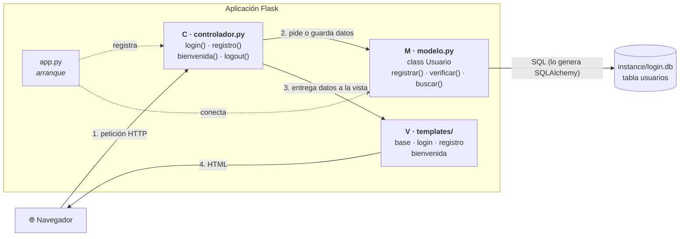
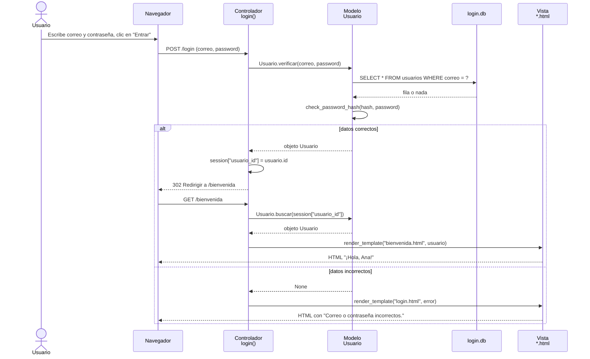
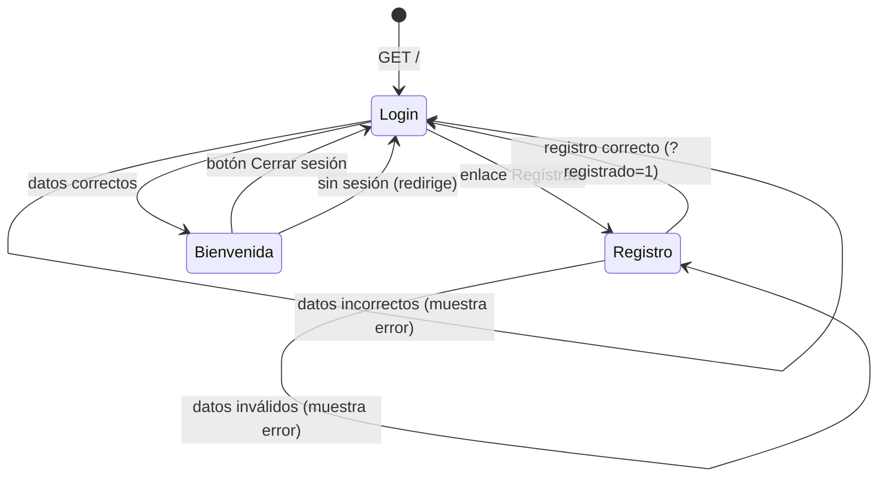
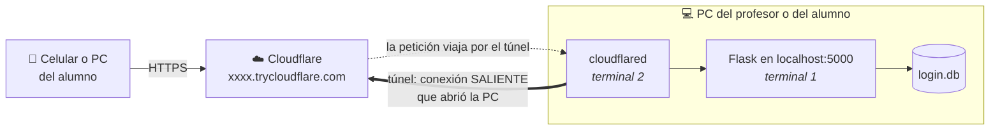

# Diagramas — LOGIN con Flask y MVC

Se ven dibujados en VS Code (vista previa del Markdown, `Ctrl + Shift + V`, con la extensión *Markdown Preview Mermaid Support*), en GitHub o en <https://mermaid.live>.

| # | Diagrama | Responde a… |
|---|---|---|
| 0 | Instalación y configuración | ¿Qué instalo y configuro, y en qué orden? |
| 1 | Casos de uso | ¿Qué puede hacer cada usuario? |
| 2 | Piezas del MVC | ¿Cómo está construida la app? |
| 3 | Secuencia de inicio de sesión | ¿Qué pasa, paso a paso, al dar clic en "Entrar"? |
| 4 | Navegación | ¿A qué página me lleva cada acción? |
| 5 | Despliegue con Cloudflare | ¿Cómo llega un celular a mi PC? |

---

## 0. Instalación y configuración: de cero a compartir

Los rombos son preguntas que tú respondes. Las cajas amarillas son instalaciones (una sola vez por computadora) y las verdes, comprobaciones de que todo va bien.

### Configuraciones de la app (variables de entorno)

Todas son **opcionales**: si no se definen, `app.py` usa el valor por defecto.

| Variable | Por defecto | Para qué sirve | Cómo se define en PowerShell |
|---|---|---|---|
| `SECRET_KEY` | `clave-solo-para-clase` | Firma la cookie de sesión. Si alguien la conoce, puede falsificar sesiones. | `$env:SECRET_KEY = "algo-largo-y-secreto"` |
| `DATABASE_URL` | `sqlite:///login.db` (archivo `instance/login.db`) | Dónde se guardan los usuarios. | `$env:DATABASE_URL = "mysql+pymysql://root:@localhost/login_app"` |
| `PORT` | `5000` | Puerto de `python app.py`. Con `flask run` se usa `--port`. | `$env:PORT = "5001"` |

> Las variables `$env:` solo duran **mientras esa terminal esté abierta**. Hay que definirlas **antes** de encender la app.

### Lo que se instala y dónde queda

| Qué | Dónde | Alcance |
|---|---|---|
| Python | `C:\Users\<tú>\AppData\Local\Programs\Python\` | Toda la PC |
| `cloudflared` | `C:\Program Files (x86)\cloudflared\` | Toda la PC |
| Flask y Flask-SQLAlchemy | `LOGIN_MVC\venv\` | **Solo este proyecto.** Si borras `venv`, lo reinstalas con `pip`. |
| La base de datos | `LOGIN_MVC\instance\login.db` | Solo este proyecto. Si la borras, empiezas sin usuarios. |

---

## 1. Diagrama de casos de uso

Qué puede hacer cada actor. Mermaid no tiene diagrama de casos de uso de UML, así que se dibuja con un diagrama de flujo: los óvalos son los casos de uso.

| Caso de uso | Ruta | Resultado |
|---|---|---|
| Registrarse | `GET/POST /registro` | Crea la fila en `usuarios` y redirige a `/login?registrado=1`. |
| Iniciar sesión | `GET/POST /login` | Guarda `usuario_id` en la sesión y redirige a `/bienvenida`. |
| Ver mis datos | `GET /bienvenida` | Muestra los datos. **Sin sesión** redirige a `/login`. |
| Cerrar sesión | `GET /logout` | Borra la sesión y redirige a `/login`. |

---

## 2. Las piezas del MVC

Quién conoce a quién. Las flechas indican "llama a" o "usa".

**Lo que nunca pasa:** la Vista no habla con el Modelo ni con la base de datos, y el Modelo no sabe nada de HTML ni de `request`.

---

## 3. Secuencia: iniciar sesión

---

## 4. Navegación entre páginas

---

## 5. Despliegue en servidor local con Cloudflare Tunnel

